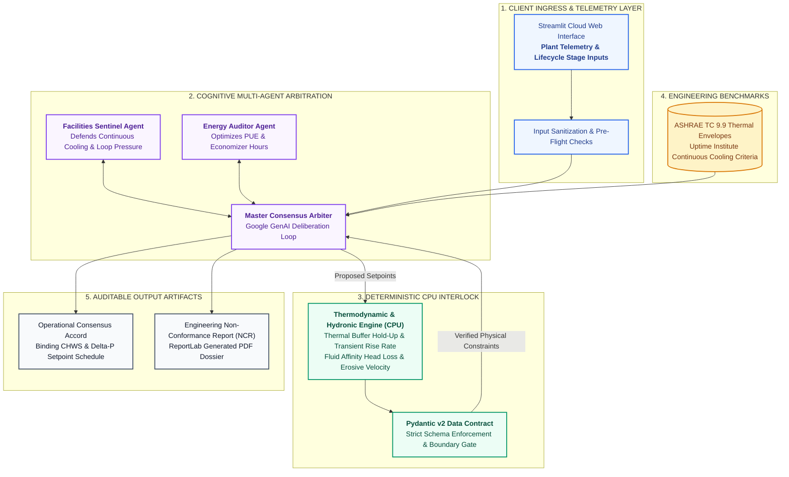

# Sentry-MAS: Autonomous Data Center Multi-Agent Arbiter & CxA Suite

> **Dataset & Confidentiality Note:** This application is an independent engineering architecture demonstration validated on representative, anonymized project datasets.

---

### Executive Problem Statement
In high-density data centers ($60\text{ to }100+\text{ kW/rack}$), two operational mandates constantly collide:
* **Facilities & Operations:** Defends zero-downtime reliability, Uptime Tier IV continuous cooling hold-up, high loop differential pressure ($\Delta P \ge 2.2\text{ bar}$), and cold supply water ($7\text{–}9^\circ\text{C}$).
* **Energy & Sustainability:** Targets Power Usage Effectiveness (PUE) compression, free-cooling hours, dynamic pressure resets, and elevated supply temperatures ($14\text{–}18^\circ\text{C}$).

When control loops fight each other, facilities suffer valve hunting, low-$\Delta T$ syndrome, and chiller short-cycling. **Sentry-MAS** resolves this conflict using deterministic thermodynamics and multi-agent arbitration rather than LLM guesswork.

### Operational Value
* **Eliminates Inter-Silo Deadlock:** Reconciles Facilities and Sustainability priorities transparently across Concept Design, Level 5 Integrated Systems Testing (IST), and Day-2 Live Operations.
* **Protects Compute Uptime:** Evaluates chilled-water thermal buffer hold-up and transient temperature rise rates against ASHRAE TC 9.9 thermal envelopes before authorizing energy resets.
* **Auditable Engineering Governance:** Calculates an Operational Compromise Index (OCI) and programmatically generates a formal Engineering Non-Conformance Report (NCR) PDF whenever safety margins are breached.

---

### System Architecture

---

### Core Engineering Equations Enforced on CPU
1. **Chilled Water Thermal Buffer Hold-Up:**  
   $$t_{\text{hold-up}} = \frac{V_{\text{buffer}} \times 500 \times \Delta T_{\text{allowable}}}{Q_{\text{IT, BTU/hr}}}$$
2. **Pump Affinity & Differential Pressure Scaling:**  
   $$\Delta P_2 = \Delta P_1 \left(\frac{N_2}{N_1}\right)^2, \quad P_{\text{shaft},2} = P_{\text{shaft},1} \left(\frac{N_2}{N_1}\right)^3$$

---

### Technology Stack
* **Runtime & UI:** Python 3.12, Streamlit Community Cloud
* **Cognitive Engine:** Google GenAI SDK (`gemini-3.8-flash`)
* **Validation & Reporting:** Pydantic v2, ReportLab PDF Engine, NumPy

### Author & Architect
**Rohit Kumar, PMP, CEng, CEA, FSEr (TÜV)**  
Cross-Technology Technical Architect | Mission-Critical Infrastructure & Applied AI Solutions  
[LinkedIn](https://www.linkedin.com/in/rohitg41) | [Live Application](https://sentry-mas-arbiter.streamlit.app)

---

### Enterprise Advisory & Custom Architecture
Available for technical consulting, custom agentic workflow development, and private enterprise deployments.  
**Connect:** [LinkedIn](https://www.linkedin.com/in/rohitg41) | **Email:** `grohit41@gmail.com`

---

### Intellectual Property & Licensing
**Copyright © 2026 Rohit Kumar. All Rights Reserved.**  
This repository and its source code are published solely for technical portfolio evaluation and architectural demonstration. Unauthorized copying, redistribution, or commercial deployment is prohibited without prior written consent.
